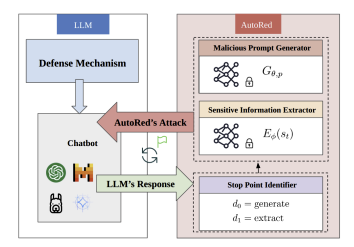








I'm a 2nd year PhD student in Computer Science at Simon Fraser University, fortunate to be supervised by Dr. [Linyi Li](https://cs.sfu.ca/~linyi/) in the [Trustworthy AI (TAI) Lab](https://sfu-tai.github.io/). 

I am broadly interested in large language models. My research interests include:

- **Model architecture:** [model depth](s5_blog_preview_conclusion.html), looped models, and test-time training.
- **Model training:** [curriculum learning](s5_blog_preview_conclusion.html).
- **LLM alignment:** [red teaming](https://ieeexplore.ieee.org/abstract/document/10825267), potential threats that frontier LLMs may pose to society.

# 🔥 News
- *2026.11*: Dumped my first blog on model depth: [When Attention Learns Group Composition](s5_blog_preview_conclusion.html).
- *2026.01*: Completed PhD coursework and breadth exam requirements.
- *2025.06*: &nbsp;🎉🎉 Participated in a hackathon with developers from my team at SAP about AI model governance.

# 📝 Publications 

  
  

    <strong><a href="https://ieeexplore.ieee.org/abstract/document/10825267" target="_blank">AutoRed: Automated Attack Scenario Generation Framework for Red Teaming of LLMs</a></strong> 
    <strong>Zhe Wang</strong>, M. A. Tayebi 
    <em>IEEE BigData 2024</em> 
    We present <strong>AutoRed</strong>, a red-teaming framework that proactively generates adversarial prompts to challenge LLMs’ refusal strategies and safety alignment.
  

<!-- # 🎖 Honors and Awards
- *2017.10* **First Prize**, Zhoushan division of the Zhejiang Provincial High School Mathematics Olympiad. -->

# 📖 Educations
- *2025.09 - Present*, Ph.D., Computer Science at Simon Fraser University
- *2022.09 - 2024.05*, M.Sc., Computer Science at Simon Fraser University
- *2018.09 - 2022.07*, B.Sc., Mathematics and Applied Mathematics at The Chinese University of Hong Kong, Shenzhen

# 💬 Invited Talks
- *2025.06*, _The Art of LLM Evaluation_, AI Lunch and Learn at SAP Canada, Vancouver office. 

# 📝 Blog
- [When Attention Learns Group Composition](s5_blog_preview_conclusion.html)

# 💻 Internships
- *2026.01 - 2026.09*, Mitacs Research Intern, RBC Borealis, Canada.
- *2024.09 - 2025.08*, Research and Development Intern, SAP, Canada.
- *2023.07 - 2023.09*, Machine Learning Research Intern, Hanglok-Tech, China.

# 🖋️Services
- Conference Reviewer: WWW, EMNLP
